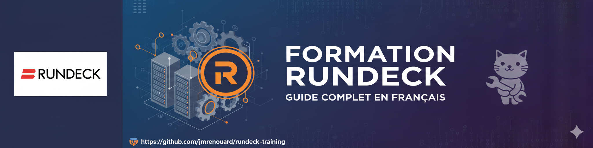
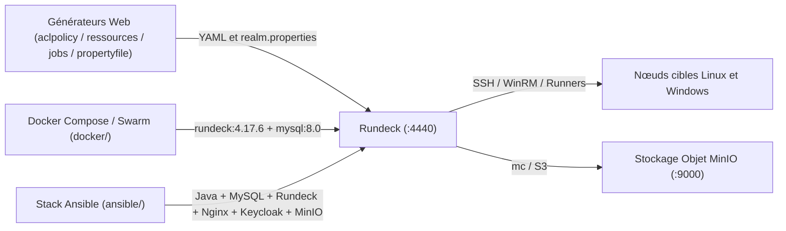

# Projet d'Automatisation et de Déploiement de Rundeck

> **Langue :** Français | [English](README.md)

Ce projet fournit une collection complète d'outils pour déployer, configurer et gérer un environnement **Rundeck** sous **Docker Compose**, **Docker Swarm**, **Ansible** et scripts **Ubuntu**, avec une intégration **MinIO/S3**, 68 templates de jobs YAML et quatre générateurs web interactifs.

## Architecture Globale



## Portail Documentation (Diátaxis FR)

La documentation structurée en français se trouve dans [`docs/fr/index.md`](docs/fr/index.md) :

- **Tutoriels :** [Démarrage Docker Rundeck et atelier pratique](docs/fr/01-tutoriels/index.md)
- **Guides pratiques :** [Procédures en Français Technique Simplifié (ASD-STF100)](docs/fr/02-guides-pratiques/index.md)
- **Référence :** [Ports, Ansible, ACLPolicy et inventaire des scripts](docs/fr/03-reference/index.md)
- **Explications :** [Modèles de déploiement, ACL et gestion des secrets](docs/fr/04-explications/index.md)

La documentation Diátaxis anglaise est accessible dans [README.md](README.md) et [`docs/index.md`](docs/index.md).

## Composants Principaux

### [Ansible](./ansible/README.md)
Playbooks et rôles Ansible pour automatiser le déploiement complet (`java`, `mysql`, `rundeck`, `nginx`, `keycloak`, `minio`).

### [Docker](./docker/README.md)
Configurations Docker Compose et Docker Swarm (`docker-compose.yml`, `docker-swarm.yml`, `Makefile`) pour lancer rapidement Rundeck `4.17.6` avec MySQL `8.0`.

### [Scripts](./scripts/README.md)
Collection de scripts Bash pour l'installation sur Ubuntu, la configuration Docker, la sauvegarde et la restauration de Rundeck ainsi que MinIO.

### [Templates](./templates/README.md)
Bibliothèque de 68 templates de jobs Rundeck YAML pour Linux et Windows (déploiement, intégration MinIO/S3, maintenance, sauvegarde/restauration, reporting et sécurité).

### [Feuille de route](./roadmap.md)
Propositions d'évolution CI/CD, sécurité, observabilité et tests Ansible.

## Utilitaires Web

| Outil | Documentation | Description |
| :--- | :--- | :--- |
| **Générateur ACLPolicy** | [`aclpolicy/README.md`](aclpolicy/README.md) | Interface Alpine.js/Tailwind pour créer et importer des fichiers `.aclpolicy` multi-documents |
| **Générateur de Ressources** | [`ressources/README.md`](ressources/README.md) | Interface pour générer les fichiers YAML `resources.yml` des nœuds |
| **Générateur de Jobs** | [`jobs/README.md`](jobs/README.md) | Constructeur visuel FR/EN de définitions de jobs YAML (`exec`, `script`, `jobref`) |
| **Générateur Propertyfile** | [`propertyfile/README.md`](propertyfile/README.md) | Outil FR/EN pour générer `realm.properties` (`plaintext`, `OBF`, `MD5`, `BCRYPT`) |

## Vérifications Automatisées

```bash
python3 -m unittest discover -s tests -p "test_*.py" -v
```
