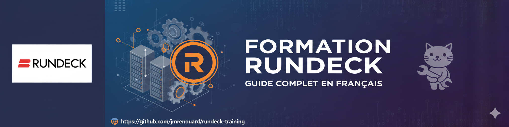
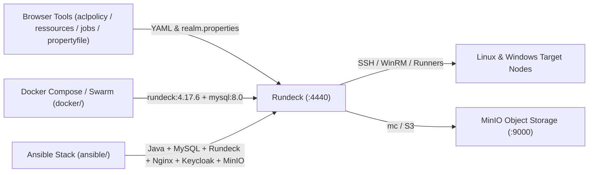

# Rundeck Automation, Deployment & Training Suite

> **Language:** English | [Français](README.fr.md)

This repository provides a complete training environment for deploying, automating, securing, and operating **Rundeck** across Docker Compose, Docker Swarm, Ansible, Ubuntu shell installers, MinIO/S3 object storage, over 60 job YAML templates, and four browser-based YAML/ACL/property configuration generators.

## Architecture Overview



## Documentation Portal (Diátaxis)

English structured documentation lives under [`docs/`](docs/index.md):

- **Tutorials:** [Docker Rundeck Quickstart & Ansible/ACL/MinIO Lab](docs/01-tutorials/index.md)
- **How-To Guides:** [Operational Runbooks (ASD-STE100 Issue 9)](docs/02-how-to-guides/index.md)
- **Reference:** [Compose, Ansible, ACLPolicy, Templates & Script Matrix](docs/03-reference/index.md)
- **Explanation:** [Deployment Models, RBAC ACLs & Credential Security](docs/04-explanation/index.md)

French operational documentation and localized subproject guides live in [README.fr.md](README.fr.md) and [`docs/fr/index.md`](docs/fr/index.md).

## Main Components & Interactive Generators

| Component | Path | Description |
| :--- | :--- | :--- |
| **Docker & Swarm Stack** | [`docker/docker-compose.yml`](docker/docker-compose.yml) | Containerized Rundeck `4.17.6` + MySQL `8.0` Compose and Swarm definitions |
| **Ansible Playbooks** | [`ansible/playbooks/`](ansible/playbooks/site.yml) | Modular roles for `java`, `mysql`, `rundeck`, `nginx`, `keycloak`, and `minio` |
| **Job YAML Templates** | [`templates/`](templates/README.md) | 64 ready-to-import YAML job definitions for Linux, Windows, and MinIO/S3 |
| **Shell Scripts** | [`scripts/`](scripts/README.md) | Ubuntu bare-metal installers, backup/restore automation, and Docker setup |
| **ACLPolicy Generator** | [`aclpolicy/index.html`](aclpolicy/index.html) | Bilingual web builder for `.aclpolicy` YAML documents |
| **Resources Generator** | [`ressources/index.html`](ressources/index.html) | Bilingual web builder for Rundeck node `resources.yml` files |
| **Job YAML Generator** | [`jobs/index.html`](jobs/index.html) | Interactive EN/FR builder for multi-step Rundeck job definitions |
| **Property File Generator** | [`propertyfile/README.en.md`](propertyfile/README.en.md) | Interactive EN/FR generator for `realm.properties` (`plaintext`, `OBF`, `MD5`, `BCRYPT`) |

## Quick Start (Docker Compose)

```bash
cp docker/.env.example docker/.env
docker compose --env-file docker/.env -f docker/docker-compose.yml config -q
make -C docker up
```

Open Rundeck at `http://localhost:4440` (`RUNDECK_PORT` in `docker/.env`).

## Automated Verification

Run the repository validation suite (YAML/ACL/templates, Compose manifest, shell syntax, Python syntax, link checks, Mermaid compilation, FR/EN isolation, and Diátaxis rules):

```bash
python3 -m unittest discover -s tests -p "test_*.py" -v
```
