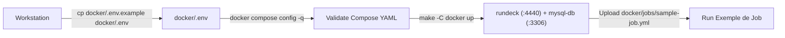

# Tutorial 1: Docker Rundeck Quickstart Lab

In this tutorial, you configure `docker/.env` from `docker/.env.example`, validate the Compose manifest, start containerized **Rundeck 4.17.6** with **MySQL 8.0**, and run your first YAML job (`docker/jobs/sample-job.yml`).

- **Estimated Time:** 10 minutes
- **Files Used:** `docker/.env.example`, `docker/docker-compose.yml`, `docker/Makefile`, `docker/jobs/sample-job.yml`

## Prerequisites

- Docker Engine and Docker Compose V2 (`docker compose version`)
- GNU Make and Python 3 on your host

## Container Startup Flow



## Step 1: Prepare Environment Variables and Validate Compose

Copy the environment template and verify `docker/docker-compose.yml` parses cleanly:

```bash
cp -n docker/.env.example docker/.env
docker compose --env-file docker/.env -f docker/docker-compose.yml config -q
```

Inspect default ports in `docker/.env`: `RUNDECK_PORT=4440`, `MYSQL_PORT=3306`, `RUNDECK_DATA_DIR=./rundeck-data`, and `MYSQL_DATA_DIR=./mysql-data`.

## Step 2: Start Rundeck and MySQL Containers

Launch the detached services via `docker/Makefile` (or `docker compose --env-file docker/.env -f docker/docker-compose.yml up -d`):

```bash
make -C docker up
make -C docker ps
```

Wait roughly 30–60 seconds for Rundeck's Grails runtime to initialize the `rundeck` schema inside `mysql-db`.

## Step 3: Open Rundeck and Import `docker/jobs/sample-job.yml`

1. Validate the sample job YAML locally before uploading:

```bash
python3 -c "import yaml, pathlib; list(yaml.safe_load_all(pathlib.Path('docker/jobs/sample-job.yml').read_text()))"
```

2. Open `http://localhost:4440` in your browser and sign in with the default lab credentials (`admin` / `admin`).
3. Create a project, navigate to **Jobs -> Upload Definition**, select `docker/jobs/sample-job.yml`, and run **Exemple de Job - Dire Bonjour**.

## Step 4: Tear Down the Lab

```bash
make -C docker down
```

## Next Steps

- Continue to [Tutorial 2: Ansible, ACLPolicy, and MinIO S3 Integration Lab](02-ansible-acl-and-minio-lab.md).
- Inspect all service variables and Makefile targets in [Reference: Compose, Ansible, ACLPolicy, and Scripts](../03-reference/compose-ansible-acl-and-scripts.md).
