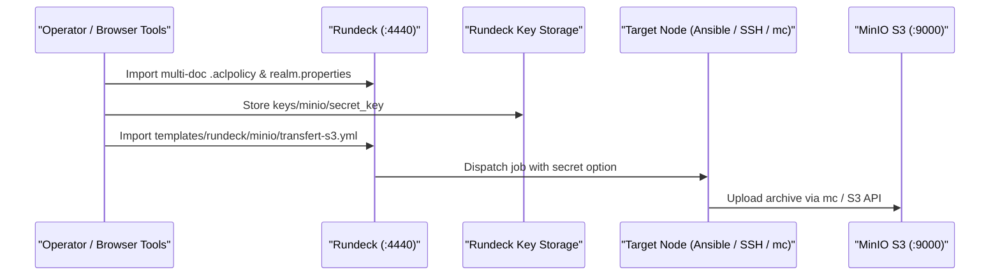

# Tutorial 2: Ansible, ACLPolicy, and MinIO S3 Integration Lab

In this tutorial, you inspect Ansible playbook orchestration (`ansible/playbooks/site.yml`), validate a multi-document `.aclpolicy`, generate `realm.properties`, and test a Rundeck S3 job definition (`templates/rundeck/minio/transfert-s3.yml`).

- **Estimated Time:** 15 minutes
- **Prerequisites:** Completed [Tutorial 1](01-docker-rundeck-quickstart.md) or local YAML/Python tooling

## Integration Architecture



## Step 1: Validate Ansible Playbooks and Role Defaults

Validate YAML syntax across every Ansible playbook and role variable file:

```bash
python3 -c "import yaml, pathlib; [list(yaml.safe_load_all(p.read_text())) for p in sorted(pathlib.Path('ansible').rglob('*.yml'))]"
```

Review `ansible/playbooks/site.yml` to see the deployment order: `java` -> `mysql` -> `rundeck` -> `nginx` -> `keycloak` -> `minio`.

## Step 2: Create User Credentials and ACL Policies

1. Open [`propertyfile/index.html`](../../propertyfile/README.en.md) in a browser, add a `grp_WebApp_developer` user hashed with **BCRYPT**, and save the snippet into `realm.properties`.
2. Open [`aclpolicy/index.html`](../../aclpolicy/index.html) to generate a multi-document `.aclpolicy` file separated by `---`:

```yaml
description: "List WebApp project"
by:
  group: grp_WebApp_developer
context:
  application: 'rundeck'
for:
  system:
    - allow: [read]
---
description: "Run jobs in WebApp"
by:
  group: grp_WebApp_developer
context:
  project: 'WebApp'
for:
  project:
    - allow: [read]
  job:
    - allow: [create, read, update, delete, run, kill]
  node:
    - allow: [read, run]
```

## Step 3: Validate Job Templates and MinIO S3 Integration

Check that `templates/rundeck/minio/transfert-s3.yml` and all 64 YAML templates parse cleanly:

```bash
python3 -c "import yaml, pathlib; files = sorted(pathlib.Path('templates').rglob('*.y*ml')); [list(yaml.safe_load_all(f.read_text())) for f in files]; print(f'Templates validated: {len(files)}')"
```

Before executing `transfert-s3.yml` against MinIO (`http://localhost:9000`), store your S3 secret in Rundeck **Project Settings -> Key Storage** under `keys/minio/secret_key` instead of passing plaintext secrets.

## Next Steps

- Apply [How-To: Deploy Docker Compose and Docker Swarm Stacks](../02-how-to-guides/deploy-docker-and-swarm.md).
- Read [Explanation: Deployment Models, ACL Design, and Credential Posture](../04-explanation/architecture-acl-and-deployment-models.md).
