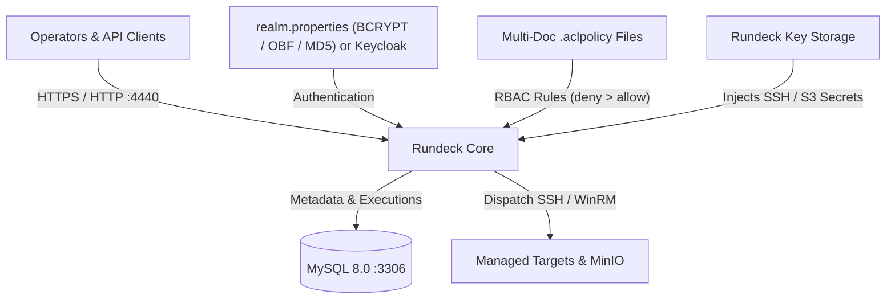

# Deployment Models, ACL Design, and Credential Posture

This explanation contrasts the three Rundeck provisioning tracks in `rundeck-training`, clarifies how multi-document `.aclpolicy` files are evaluated, and documents current security trade-offs.

## Platform Component Relationships

## Choosing a Deployment Track

1. **Docker Compose (`docker/docker-compose.yml`):** Fastest local sandbox pairing `rundeck/rundeck:4.17.6` with `mysql:8.0` and host-mounted data directories (`./rundeck-data`, `./mysql-data`).
2. **Docker Swarm (`docker/docker-swarm.yml`):** Single-manager replicated stack definition using named persistent volumes and `on-failure` restart policies.
3. **Bare-Metal Ansible (`ansible/`) and Ubuntu Scripts (`scripts/`):** Role-based provisioning for `java`, `mysql`, `rundeck`, `nginx`, `keycloak`, and `minio` on Debian/Ubuntu hosts (`systemd`).

## Multi-Document `.aclpolicy` Evaluation

Rundeck interprets each `---`-delimited document inside a `.aclpolicy` file independently, matching either `application: 'rundeck'` (global system scope, project listing) or `project: '<name>'` (job and node operations). Combining two `context:` / `for:` pairs inside one YAML mapping without `---` causes standard YAML parsers to overwrite the first rule with the second; using `---` or `aclpolicy/index.html` ensures every scope remains active, with explicit `deny` rules overriding `allow`.

## Current Lab Security Posture

- **MySQL Connection Strings:** `docker/docker-compose.yml` and `docker/docker-swarm.yml` include `useSSL=false` in `RUNDECK_DATABASE_URL` for container network convenience; enable TLS certificates when deploying beyond a trusted local Docker bridge.
- **Bare-Metal Installer Defaults:** `scripts/install_mysql.sh`, `scripts/install_rundeck.sh`, and `scripts/backup_rundeck.sh` contain sample lab credential defaults (`rundeckpassword`), whereas `ansible/roles/mysql/defaults/main.yml` and `ansible/roles/rundeck/defaults/main.yml` leave database passwords unset so operators supply Ansible Vault values.
