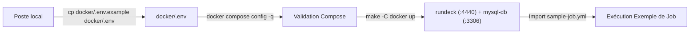

# Atelier 1 : Démarrer Rundeck sous Docker Compose et importer un job

Dans cet atelier, vous configurez `docker/.env`, validez le fichier Compose, lancez **Rundeck 4.17.6** avec **MySQL 8.0**, puis importez le job d'exemple `docker/jobs/sample-job.yml`.

- **Durée estimée :** 10 minutes
- **Fichiers utilisés :** `docker/.env.example`, `docker/docker-compose.yml`, `docker/Makefile`, `docker/jobs/sample-job.yml`

## Prérequis

- Docker Engine et Docker Compose V2 installés sur le poste
- GNU Make et Python 3 disponibles

## Flux de démarrage



## Étape 1 : Initialiser `.env` et valider Compose

Copiez le modèle d'environnement puis contrôlez la syntaxe de `docker/docker-compose.yml` :

```bash
cp -n docker/.env.example docker/.env
docker compose --env-file docker/.env -f docker/docker-compose.yml config -q
```

Les variables par défaut configurent `RUNDECK_PORT=4440`, `MYSQL_PORT=3306`, `RUNDECK_DATA_DIR=./rundeck-data` et `MYSQL_DATA_DIR=./mysql-data`.

## Étape 2 : Démarrer les conteneurs Rundeck et MySQL

```bash
make -C docker up
make -C docker ps
```

Patientez environ 45 secondes afin que Rundeck initialise la base MySQL `rundeck`.

## Étape 3 : Valider et importer `docker/jobs/sample-job.yml`

```bash
python3 -c "import yaml, pathlib; list(yaml.safe_load_all(pathlib.Path('docker/jobs/sample-job.yml').read_text()))"
```

Ouvrez ensuite `http://localhost:4440`, connectez-vous (`admin` / `admin`), créez un projet et importez `docker/jobs/sample-job.yml` via **Jobs -> Upload Definition**.

## Étape 4 : Arrêter la stack

```bash
make -C docker down
```

## Étapes suivantes

- Appliquez [Guide pratique : Déployer Rundeck sous Docker Compose et Swarm](../02-guides-pratiques/deployer-docker-et-swarm.md).
- Consultez les modèles d'ACL dans [`docs/droits_comptes_rundeck.md`](../../droits_comptes_rundeck.md).
