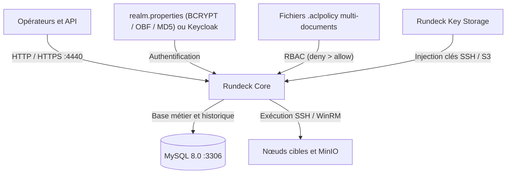

# Architecture ACL et modes de déploiement

Ce document analyse les trois voies de déploiement de `rundeck-training`, le fonctionnement interne des règles `.aclpolicy` et la gestion des secrets.

## Relations entre composants

## Trois modèles de déploiement

1. **Docker Compose (`docker/docker-compose.yml`) :** Bac à sable local rapide combinant `rundeck/rundeck:4.17.6` et `mysql:8.0` avec persistance locale (`./rundeck-data`, `./mysql-data`).
2. **Docker Swarm (`docker/docker-swarm.yml`) :** Déploiement en stack managée sur nœud `manager` avec volumes nommés et redémarrage automatique `on-failure`.
3. **Ansible (`ansible/`) et Scripts Ubuntu (`scripts/`) :** Provisionnement hôte par rôles (`java`, `mysql`, `rundeck`, `nginx`, `keycloak`, `minio`) ou scripts systemd sur Debian/Ubuntu.

## Évaluation multi-documents `.aclpolicy` et hygiène des secrets

Rundeck évalue chaque bloc séparé par `---` comme une politique distincte (`application: 'rundeck'` au niveau système ou `project: '<nom>'` au niveau projet), en donnant priorité aux directives `deny` sur `allow`. Placer deux blocs `context` / `for` sans séparateur `---` provoque l'écrasement silencieux de la première règle lors du chargement YAML. Enfin, les scripts bare-metal (`install_mysql.sh`, `install_rundeck.sh`, `backup_rundeck.sh`) embarquent des identifiants de test par défaut (`rundeckpassword`), tandis que les rôles Ansible laissent les mots de passe vides pour injection via Ansible Vault.
